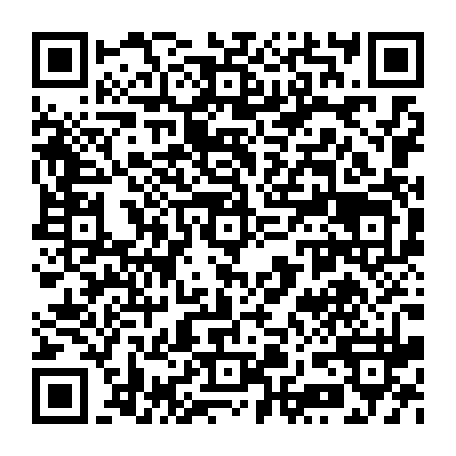

# File Manager Test for Amazfit Balance

The original File Manager was created by Arigato Software. Tenebras contributed the changes in this test branch.

## Install on Amazfit Balance

Scan this QR code in Zepp Developer Mode. The preview expires on 25.11.2026, 00:04 MSK according to the package metadata.

The new app appears as **File Manager Test** or **Проводник — тест** in the watch menu. It uses a separate App ID (9284653).

1. In the watch app, open `[root] → baro_altim` and select **Record updates** (**Записать обновления**).
2. Select 5, 10, or 20 minutes. The app takes a reading at the start and every 30 seconds. Leave this screen open during the test.
3. Scan **Changes QR** (**Изменения в QR**) for the baseline and changes in `baro_manager.dat`, or **Full log QR** (**Все проверки в QR**) for every reading.

[Download the test package](preview/file-manager-balance-observation-2.zpk) · [Original File Manager](https://github.com/Arigato-Software/zeppos-file-manager-app) · [ISC license](LICENSE)
